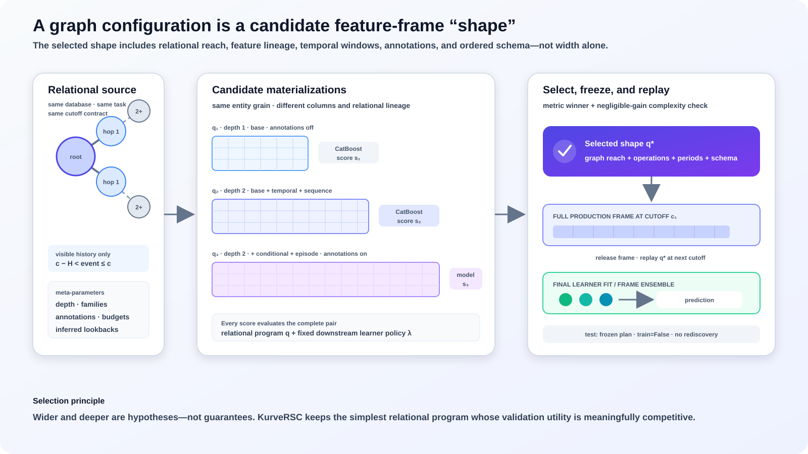

# KurveRSC

> **Maintainer-reproduced release:** KurveRSC 0.2.0 / GraphReduce 1.10.18 now
> covers all 21 RelArena tasks. On the November 5, 2026 combined leaderboard,
> KurveRSC ranks **#2 overall and first among systems**, at **1913.4 Elo**.
> See the [reproduced results](docs/kurversc-reproduced-results.md),
> [technical report](docs/kurversc-staged-technical-report.md) and
> [release specification](docs/staged-release.md).

KurveRSC is an integrated relational representation and model-selection
system. It uses [GraphReduce](https://github.com/wesmadrigal/graphreduce) as
its relational feature engine, searches graph configurations
across temporal frames, and selects them by downstream validation performance.

<p align="center">
  <a href="https://kurve.ai/research">Kurve Research</a> ·
  <a href="https://kurve.ai/blog/kurversc-learning-the-shape-of-relational-signal">KurveRSC Article</a> ·
  <a href="docs/staged-release.md">Current Procedure</a> ·
  <a href="docs/kurversc-staged-technical-report.pdf">Technical Report</a> ·
  <a href="#citation">Citation</a> ·
  <a href="https://pypi.org/project/kurversc/">PyPI</a>
</p>

<p align="center">
  
</p>

<p align="center"><em>KurveRSC searches the relational signal-compression space and fits the selected shape on full point-in-time data.</em></p>

> **Thesis.** Relational signal compression is a first-class optimization
> surface. Long-term progress will come not only from improving the downstream
> learner, but from learning which paths, time windows, reductions, and feature
> families should carry a database's task-relevant signal into that learner.
> Keeping this boundary explicit makes the learner pluggable: today CatBoost;
> tomorrow TabPFN-3 or another tabular or relational foundation model.

Kurve has pursued this direction from the outset: predictive performance
depends on adapting the relational representation as well as the learner that
consumes it. Recent independent results validate that longstanding bet from
adjacent directions. KumoRFM-2 reports that task-specific fine-tuning improves
its average SALT MRR from 0.83 in-context to 0.89, showing that even a strong
relational foundation model benefits materially from task adaptation
([KumoRFM-2](https://arxiv.org/abs/2604.12596)). Prior Labs' TabPFN-Rel couples
Deep Feature Synthesis with TabPFN-3 and obtains leading RelArena results,
demonstrating the value of giving a foundation learner a separately constructed
relational representation
([RelArena and TabPFN-Rel](https://arxiv.org/abs/2608.16319)). Neither system
optimizes exactly the same object as KurveRSC, but both reinforce KurveRSC's
original modular thesis: relational representation and downstream learning
should be adapted jointly without permanently binding either layer to the
other.

### How KurveRSC differs from Deep Feature Synthesis

**Deep Feature Synthesis generates a relational feature space; KurveRSC
selects a relational program by measuring how well its complete feature frame
works with the downstream learner.**

| Dimension | Deep Feature Synthesis | GraphReduce | KurveRSC |
|---|---|---|---|
| Primary object | Composed feature definitions | Executable table graph and node operations | Search over complete GraphReduce programs |
| Learner role | Normally fitted after synthesis | External to the execution engine | In the loop: AUROC or MAE scores every candidate frame |
| Task adaptation | Caller chooses primitives and depth; later feature selection can remove columns | Caller configures one graph program | Search jointly chooses depth, families, annotations, budgets, and temporal policy |
| Final artifact | Feature definitions and materialized table | Reduced frame and operation lineage | Selected configuration, frozen execution plan, schema, and fitted learner |
| Inference | Recompute the chosen definitions | Re-execute the configured graph | Replay the learned plan with feature discovery disabled |

Learner regularization over a wide DFS matrix can choose among columns that
were generated, but it cannot recover paths, time windows, feature families,
or propagation depths that were never materialized. KurveRSC makes those
upstream choices part of validation-guided selection while retaining a
replaceable downstream model. See the technical report's
[discussion of relational feature construction](docs/kurversc-staged-technical-report.md#relational-feature-construction-and-learned-neighborhood-representations).

The [KurveRSC 0.2.0 technical report](docs/kurversc-staged-technical-report.md)
([PDF](docs/kurversc-staged-technical-report.pdf)) specifies the architecture,
GraphReduce feature families, staged graph search, shared selection rules,
strict temporal boundaries, frozen-plan lifecycle, maintainer-reproduced results
and measured resources for this release.

## Complete staged pipeline (0.2.0)

The complete staged procedure is available through `TaskContext`,
`run_staged_task` and the `kurversc-staged` command. It includes graph search,
production-faithful finalist checks, temporal support/readout selection and
final refitting. Native `fit` / `predict` remain component interfaces.

See [the published procedure](docs/staged-release.md),
[maintainer-reproduced results](docs/kurversc-reproduced-results.md) and
[current resource measurements](docs/kurversc-staged-resources.md).

## Quickstart

The native graph-fitting API is one function. The complete
[0.2.0 staged procedure](docs/staged-release.md) includes temporal-policy and
readout selection. For the native API, give `fit` an entity table, a
label table, their join keys, target, and authoritative train/validation split:

```bash
pip install "kurversc[relbench]"  # omit [relbench] for ordinary tables
```

```python
import kurversc

result = kurversc.fit(
    parent_node="customers.parquet",
    label_node="churn_labels.parquet",
    parent_key="customer_id",
    label_key="customer_id",
    target="churn",
    split_column="split",  # values: train / validation
)

print(result.best_config)         # highest validation ROC AUC or lowest MAE
print(result.recommended_config)  # simpler config when the gain is negligible
print(result.full_validation_score)
print(result.results)             # complete configuration-search audit trail
```

`result` is the fitted KurveRSC artifact: the selected `GraphConfig`, frozen
GraphReduce feature-operation plan, downstream learner, feature schema, and
validation metadata. Pass it to `kurversc.predict(...)` to replay the exact
learned relational program at new cutoff dates.

## Maintainer-reproduced RelArena performance

The maintainers reproduced all 21 tasks at seed 0 through the submitted adapter
using **KurveRSC 0.2.0 / GraphReduce 1.10.18 from PyPI** and merged the system
in [RelArena #80](https://github.com/PriorLabs/relarena/pull/80).

At the [November 5 snapshot](https://github.com/PriorLabs/relarena/blob/fcab8fb46b82299321c101b9a921d9a3f7c72263/README.md#-leaderboards), KurveRSC
ranks **#2 of 16 overall and first among systems**, with **1913.4 Elo**
(95% task-bootstrap interval **1832.3-2050.6**), versus **1933.6** for the latest
TabPFN-Rel client. The intervals overlap substantially. Each board is computed
separately; these are the **models plus systems** ratings.

### Per-task comparison

All scores below are selected held-out test scores from the
[merged result file](https://github.com/PriorLabs/relarena/blob/fcab8fb46b82299321c101b9a921d9a3f7c72263/baseline_results/results.csv).
AUC is higher-is-better; MAE is lower-is-better. The client is
`tabpfn-rel-client-2026-09-28`. Winners use unrounded scores.

| Dataset / task | Metric | KurveRSC 0.2.0 | TabPFN-Rel client | Winner |
|:----------------------------|:-------|-------------:|-------------:|:--------|
| Amazon / item-churn | AUC | 0.828712 | 0.828653 | KurveRSC |
| Amazon / item-ltv | MAE | 42.3828 | 45.2705 | KurveRSC |
| Amazon / user-churn | AUC | 0.712558 | 0.711698 | KurveRSC |
| Amazon / user-ltv | MAE | 13.9894 | 13.8771 | Client |
| Avito / ad-ctr | MAE | 0.033258 | 0.031258 | Client |
| Avito / user-clicks | AUC | 0.660062 | 0.691631 | Client |
| Avito / user-visits | AUC | 0.672515 | 0.672453 | KurveRSC |
| Event / user-attendance | MAE | 0.234934 | 0.241652 | KurveRSC |
| Event / user-ignore | AUC | 0.850888 | 0.784037 | KurveRSC |
| Event / user-repeat | AUC | 0.782152 | 0.760495 | KurveRSC |
| F1 / driver-dnf | AUC | 0.722017 | 0.727809 | Client |
| F1 / driver-position | MAE | 4.0605 | 3.7574 | Client |
| F1 / driver-top3 | AUC | 0.834154 | 0.791702 | KurveRSC |
| H&M / item-sales | MAE | 0.033636 | 0.036479 | KurveRSC |
| H&M / user-churn | AUC | 0.707174 | 0.706021 | KurveRSC |
| Stack / post-votes | MAE | 0.062864 | 0.062733 | Client |
| Stack / user-badge | AUC | 0.876020 | 0.883443 | Client |
| Stack / user-engagement | AUC | 0.903861 | 0.907662 | Client |
| Trial / site-success | MAE | 0.398749 | 0.377615 | Client |
| Trial / study-adverse | MAE | 33.1750 | 34.4014 | KurveRSC |
| Trial / study-outcome | AUC | 0.760476 | 0.764556 | Client |

KurveRSC wins **11/21** task comparisons against the latest client. The
[full results](docs/kurversc-reproduced-results.md) also show the earlier
KurveRSC registration and all 16 methods' published Elo ratings. The
[machine-readable extract](docs/assets/kurversc-relarena-reproduction-20261105.json)
preserves full precision and source checksums.

### Measured resources

The successful reproduced jobs take **0.71-10.60 hours** and report **4-370 GiB
Slurm MaxRSS**, one task per host. Eight use 96-vCPU/739-GB hosts and thirteen
use 48-core/190-GB hosts. User-ignore and user-engagement first ran out of
memory on smaller hosts, and post-votes was moved after reaching 140 GiB;
these three completed on the larger hosts. These observations are not minimum
RAM requirements. See the [per-task resource table](docs/kurversc-staged-resources.md)
for engine limits, measurement definitions and parallel-admission guidance.

## Native API details

Both node arguments accept a pandas DataFrame, CSV/Parquet path, or the name of
a table/view on a supplied DuckDB connection. For explicit metadata, use
`Table` and `Labels`:

```python
result = kurversc.fit(
    parent_node=kurversc.Table(
        "users", name="users", key="Id", date="CreationDate"
    ),
    label_node=kurversc.Labels(
        "user_labels",
        key="user_id",
        target="will_return",
        timestamp="timestamp",
        split="split",
    ),
    tables=[
        kurversc.Table(
            "posts", name="posts", key="Id", date="CreationDate"
        ),
        kurversc.Table(
            "comments", name="comments", key="Id", date="CreationDate"
        ),
    ],
    relationships=[
        kurversc.Relationship(
            parent="users",
            child="posts",
            parent_key="Id",
            child_key="OwnerUserId",
        ),
        kurversc.Relationship(
            parent="posts",
            child="comments",
            parent_key="Id",
            child_key="PostId",
        ),
    ],
    connection=duckdb_connection,
)
```

When the target is a future aggregation over one of the graph's event tables,
let GraphReduce generate it natively instead of supplying a materialized label
table:

```python
label_node=kurversc.GraphLabels(
    table="orders",
    field="id",
    operation="bool",
    period_days=365,
    train_cutoffs=("2023-01-01", "2024-01-01"),
    validation_cutoffs=("2025-01-01",),
    test_cutoffs=("2026-01-01",),
    target="will_order",
)
```

This executes GraphReduce's `prep_for_labels()` and automatic `do_labels`
aggregation at every cutoff. `Labels` remains the correct interface for
authoritative external targets such as official RelBench task tables.

Relationships are required when the compute graph contains feature tables:
file names alone cannot determine foreign-key direction or whether a join is
one-to-many. The two label/entity keys are also explicit so label attachment is
never guessed.

<details>
<summary><strong>What <code>fit</code> searches</strong></summary>

The default search is deterministic and starts with the smallest base-only
configuration. Before building a graph, KurveRSC profiles a small sample from
every node and utility-ranks its source columns. Structural keys and cutoff
dates are always retained. A cap therefore admits the strongest observed
source columns instead of whichever columns happen to occur first in the
physical schema.

```python
result = kurversc.fit(
    ...,
    feature_family_max_columns=4,           # fixed columns per family
    feature_family_max_features_per_column=32,
    feature_propagation_max_functions_per_column=1,
    feature_ranking_rows=2_000,
    forward_search_beam_width=2,
    screening_rows=10_000,
    sample_rows=50_000,                     # confirmation fidelity
    confirmation_top_k=8,                  # diverse 50K candidates
    rerank_top_k=3,                         # full-data finalists
    rerank_cutoff_frames=3,                 # sequential walk-forward folds
    adaptive_depth_promotion=True,
    capability_pruning=True,
    search_max_features=8_000,
    random_state=42,                        # CatBoost and sampling seed
)
```

`random_state` is a reproducibility seed, not a trial count. KurveRSC uses the
same deterministic seed for competing graph configurations so stochastic model
behavior does not favor one shape over another.

The family lattice contains independent additions of `temporal`, `sequence`,
`conditional`, and `episode` to `base`, including their combinations. It does
not require a weak family to be present before a later family can be tested.
Depth 3 is limited to combinations of `base`, `temporal`, and `sequence`; wider
conditional and episode programs use depths 1 and 2.

At the default four-column budget, the forward beam executes at most 24 graph
shapes: up to four adaptive base variants, then at most 8, 6, 4, and 2
survivors across the successive family levels. The complete 72-shape lattice remains in the audit
trail with non-executed candidates marked `pruned`. A wider budget is opt-in:
`feature_family_max_column_options=(4, 8)` adds another 72 potential records,
but only the raw narrow-budget winner and the complexity-aware narrow-budget
recommendation are promoted from four to eight source columns (with the next
score-ranked shape filling the second slot when they are identical). That
expanded funnel normally materializes at most 28 configurations rather than
exhaustively running all 144 potential combinations.

```text
default cap:       4 base + 8 singles + 6 pairs + 4 triples + 2 quadruples = 24
optional wide cap: top-2 complete narrow-cap shapes                          =  2
                                                                           ----
maximum materialized by the opt-in expanded funnel                          = 26
```

The default search is multi-fidelity. Beam-admitted configurations are first
screened with at most 10,000 rows per node. Eight structurally diverse
candidates are rebuilt and rescored with `sample_rows`: the raw and
complexity-aware leaders plus representatives of available families, deeper
propagation, and both annotation policies. The strongest three confirmed
shapes are then reranked over three complete relational cutoff folds before the
final graph program is selected. `result.results`,
`result.confirmation_results`, and `result.rerank_results` expose the three
audit trails separately.

Adaptive depth promotion evaluates both annotation policies at depth 1,
promotes only the stronger policy to depth 2, and admits depth 3 only when the
depth-2 gain exceeds both the task tolerance and validation uncertainty.
Capability pruning removes families that cannot produce operations for the
available graph schema. Finally, `search_max_features` uses the source-column
audit and observed parent widths to reject a predicted feature explosion before
its SQL is materialized. All three guards can be disabled independently.

Customize the stages with `max_depth`, `auto_annotate_options`, and
`feature_family_stages`, or pass explicit `graph_configs` to override the
frontier. Set `feature_family_max_column_options=(4, 8)` to opt into wider
refinement, or include `None` as a tier to test an uncapped finalist.
`feature_family_max_features_per_column` is a separate GraphReduce guardrail:
it prevents a single temporal or categorical source from expanding into an
unbounded number of derived SQL features. The propagation cap prevents each
already-derived column from branching again at every graph hop while retaining
its canonical continuation (`max→max`, `min→min`, `sum→sum`, `count→sum`, and
`avg→avg`). Inspect `result.feature_audit` to see every source column's role,
utility score, family rank, eligible budget tiers, and exclusion reason.

`semantic` uses automatic annotations when `auto_annotate_features=True` (or
caller-supplied GraphReduce annotations). `context` requires peer-group keys;
`Table.context_keys` supplies them directly, and the RelBench adapter derives
them from foreign keys other than the edge currently being reduced.

Every candidate holds the remaining node policy fixed: GraphReduce's native
1/3/4/7/14/30/60/90/180/365/730-day time-series periods (plus the compute
horizon when it exceeds 365 days) unless `infer_ts_periods=True`, categorical
cardinality threshold 20, categorical top-k 5, automatic text features disabled, and annotation
bounds 10 categorical columns, 4 gated numeric columns, and top-k 3. These settings are assigned to
each node explicitly so they are effective with GraphReduce 1.10.

### Optional TabPFN v3 estimator

CatBoost remains the default downstream estimator. Install the local TabPFN
integration and select v3 explicitly with:

```bash
pip install "kurversc[relbench,tabpfn]"
```

```python
result = kurversc.fit(
    **problem.fit_kwargs(),
    model_backend="tabpfn_v3",
    estimator_train_rows=10_000,
    model_params={
        "n_estimators": 2,
        "fit_mode": "low_memory",
    },
)
```

`estimator_train_rows` is applied consistently to sampled configuration
screening, full-history finalist fitting, and final train-plus-validation
fitting. Classification samples are stratified and deterministic. When the
TabPFN backend is selected without an explicit cap, KurveRSC defaults it to
10,000 rows. Graph materialization remains independent of this estimator-only
cap, and the fitted artifact can be replayed with `kurversc.predict(...)`.

By default, each search source—including labels—is exposed to GraphReduce
through a temporary DuckDB view capped at `sample_rows`. Set
`search_full_data=True` to evaluate every candidate against complete source
tables instead:

```python
result = kurversc.fit(
    parent_node=parent,
    label_node=labels,
    tables=tables,
    relationships=relationships,
    sample_rows=50_000,       # still used for ordinary sampled searches
    search_full_data=True,    # disables row sampling during config search
    full_training_frames=3,   # cutoff dates used for final frame ensembling
    infer_ts_periods=True,
    auto_text_features=False,
)
```

`search_full_data=True` uses complete rows at every eligible search cutoff
selected by `search_training_frames` for every configuration admitted by the
forward funnel. The winning
configuration is selected
directly from those validation scores unless temporal reranking is enabled,
and is then fit across the requested full-training cutoff dates. Adapters can
attach a separate connected `search_source` while retaining their uncapped
production source. A
new graph is created for every candidate because GraphReduce execution mutates
node state. If labels contain a timestamp, features are built at each label
cutoff; otherwise labels are split randomly (or by `split_column`) and the
current time is used as the feature cutoff.

Classification candidates use CatBoost and validation ROC AUC. Regression
candidates use CatBoost and validation MAE. The highest-performing candidate
is always retained as `best_trial`. KurveRSC also records feature count,
feature/model time, and an estimated validation-metric standard error. Trials
that add at least 2x as many features without improving beyond both the fixed
0.002 AUC / 0.5% relative MAE floor and the configured uncertainty threshold
are marked in `result.complexity_notes`. `recommended_trial` is the
lowest-feature candidate statistically indistinguishable from the raw winner;
`best_trial` remains the unpenalized validation winner. Set
`complexity_uncertainty_multiplier=0` to use only the fixed tolerances.

By default, rerank the three strongest confirmed finalists over three
walk-forward full-data cutoff folds:

```python
result = kurversc.fit(
    ...,
    rerank_top_k=3,
    rerank_cutoff_frames=3,
    rerank_stability_penalty=0.25,
)
```

The reranker learns and scores one cutoff frame at a time, releases it, and
then advances to the next fold. Classification maximizes mean ROC AUC minus
the configured standard-deviation penalty; regression minimizes mean MAE plus
that penalty. The raw stability-adjusted winner is selected; the complexity
guard remains a screening and audit mechanism but cannot override this
full-frame evidence. The audit trail is available as `result.rerank_results`.
Set `rerank_cutoff_frames=1` for a single full-data train-to-validation rerank;
the stability penalty is then zero because there is only one score.

</details>

<details>
<summary><strong>What the returned fitted model means</strong></summary>

`fit` has a nine-stage lifecycle:

1. Utility-rank source columns and record the capped feature-funnel audit.
2. Build beam-admitted candidates from sampled source views, or from complete
   source rows when `search_full_data=True`.
3. Rank candidates by one-frame validation ROC AUC or MAE and promote only the
   strongest graph shapes to broader source-column budgets.
4. Confirm a structurally diverse bounded candidate set at medium fidelity.
5. Rerank the three strongest confirmed candidates over sequential full-data
   walk-forward cutoff folds and select the raw stability-adjusted winner.
6. Freeze its exact GraphReduce operation plan and training-only feature schema.
7. Materialize one production cutoff at a time and fit an independent CatBoost
   model for that frame.
8. Score validation with the training-frame ensemble, then add independently
   fitted validation-frame models to the final train-plus-validation ensemble.
9. Replay the plan with `GraphReduce(train=False)` at test cutoffs and expose
   predictions as `result.test_predictions`. If an external `Labels` test
   split contains targets, KurveRSC also records a test score.

The resulting production artifact is `result.fitted_model`: selected
`GraphConfig`, frozen execution plan, ordered feature schema, CatBoost model,
and validation/test metadata. `result.model` returns its final CatBoost model;
`result.execution_plan` returns the production GraphReduce plan. Validation
and test never run feature inference or annotation again.

When `infer_ts_periods=True`, KurveRSC asks GraphReduce to infer
relationship-specific event-cadence windows. Each dated node or relationship
can then replace the initial `[7, 30, 90]` windows with compact, data-derived
lookbacks spanning the configured compute horizon. KurveRSC stores those
inferred periods inside the frozen execution plan and restores them during
validation, outer refit, and prediction; replay never re-infers them.

Replay the fitted artifact on another timestamped entity frame with the same
declarative graph metadata:

```python
predictions = kurversc.predict(
    result,
    parent_node=parent,
    prediction_node=kurversc.Labels(
        scoring_rows, key="customer_id", timestamp="timestamp"
    ),
    tables=tables,
    relationships=relationships,
)
```

The output preserves prediction-row order and adds a `prediction` column.

Point-in-time production training can use many frames. By default, every
configuration is screened on one frame at the latest eligible cutoff. With
`search_full_data=True`, that frame uses all available rows. Supply all valid
cutoffs through `GraphLabels.train_cutoffs`, or all timestamped rows through
`Labels`, then choose the incremental production frame count:

```python
result = kurversc.fit(
    ...,
    search_full_data=True,     # evaluate all candidates on complete rows
    full_training_frames=3,    # 3 evenly spaced available train cutoffs
)
```

`full_training_frames=None` (the default) uses every available training
cutoff. These are point-in-time graph frames, not partitions of raw event
tables: every frame sees the complete history allowed by its cutoff, and all
frames replay the selected operation plan. KurveRSC releases each materialized
feature frame before constructing the next one. Independent CatBoost models are
combined as an ensemble, so the final fit never concatenates those wide frames
in memory. When
`full_training_frames=1`, KurveRSC always uses the latest eligible training
cutoff. The search audit trail is available as `result.results`.

</details>

<details>
<summary><strong>Official RelBench tasks</strong></summary>

`load_relbench_problem` uses the production RelBench dataset, task tables,
date keys, primary keys, and foreign keys without adding task-specific feature
expressions:

```python
import kurversc

problem = kurversc.load_relbench_problem(
    "rel-stack",
    "user-badge",
    sample_rows=10_000,
    max_train_timestamps=1,
    max_enrichment_columns=8,
)
result = kurversc.fit(**problem.fit_kwargs(), sample_rows=10_000)
```

For a full-data configuration search followed by a three-cutoff production
fit, use:

```python
problem = kurversc.load_relbench_problem(
    "rel-stack",
    "user-badge",
    sample_rows=50_000,
    search_full_data=True,
    max_train_timestamps=3,
)
result = kurversc.fit(
    **problem.fit_kwargs(),
    sample_rows=50_000,
    search_full_data=True,
    full_training_frames=3,
    infer_ts_periods=True,
    auto_text_features=False,
)
```

This runs the beam-admitted graph configurations on complete rows at the latest
training cutoff, promotes only the strongest shapes to the wider source-column
budget, and fits the selected configuration across three cutoff dates while
retaining only one materialized feature frame.

Install the optional adapter with `pip install "kurversc[relbench]"`. The object
adapter `relbench_problem_from_objects(...)` accepts a task, an already-censored
RelBench database, and its train/validation tables; RelArena uses this path so
its official inner and outer database cutoffs remain authoritative.

Relational schemas do require keys. This adapter reads them from official
RelBench metadata; for ordinary files or database tables, provide them with
`Table` and `Relationship`. Self-referential/cyclic foreign keys are omitted
because GraphReduce currently uses an acyclic `DiGraph`; every reachable
acyclic foreign-key path is represented as its own node instance. Referenced
dimension tables reached through association/event tables are joined with
`reduce=False`; by default their projected feature attributes are capped at
eight, excluding high-cardinality free text. Pass
`max_enrichment_columns=None` to retain every dimension attribute.

For temporally meaningful relational evaluation, provide `Labels.timestamp`
and date columns on event tables. A dated parent is always filtered with
`parent.date <= Labels.timestamp` before feature inference and again through
GraphReduce's `do_filters_ops`. If the parent is a genuinely timeless entity
table, declare `Table(..., timeless=True)` explicitly; an omitted parent date
is otherwise rejected for temporal labels. Without event dates, KurveRSC
cannot distinguish historical features from future data.

</details>

<details>
<summary><strong>Local customer example</strong></summary>

[`examples/cust_data_future_order.py`](examples/cust_data_future_order.py)
contains a complete run for `/usr/local/lake/cust_data`. It derives train and
validation labels through GraphReduce for “places an order in the following
365 days,” declares
the customer root as explicitly timeless, supplies every primary/foreign key
and event date, and runs the default beam-pruned configuration funnel. The example enables
the `kurversc` logger at `INFO`, showing every attempted configuration, its
score/feature count/timing, and the selected configuration.

</details>

## Citation

If you use KurveRSC in research, please cite the
[KurveRSC technical report](docs/kurversc-staged-technical-report.pdf):

```bibtex
@techreport{madrigal2026kurversc,
  title       = {KurveRSC 0.2.0: Task-Conditioned Relational Signal Compression},
  author      = {Madrigal, Wes},
  institution = {Kurve AI},
  year        = {2026},
  month       = nov,
  url         = {https://github.com/kurveai/kurversc/blob/main/docs/kurversc-staged-technical-report.pdf}
}
```
